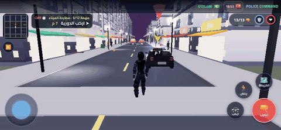
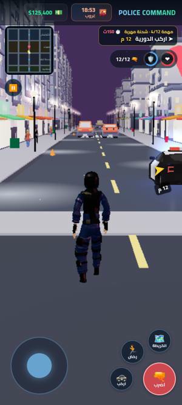
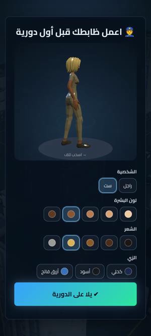
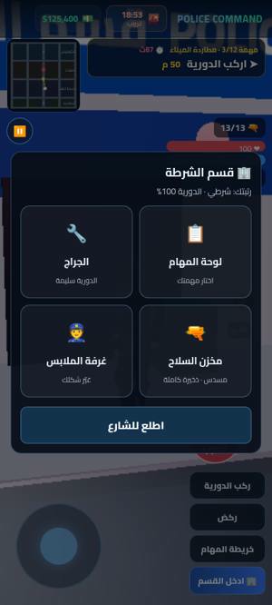
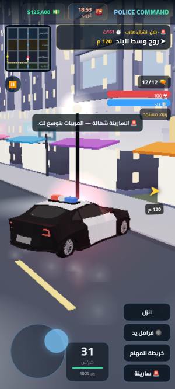
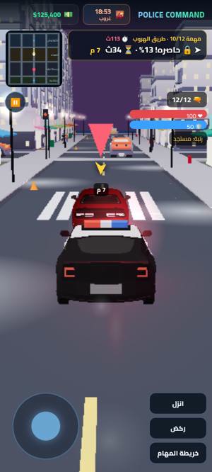
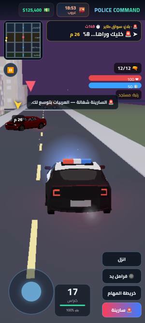

# Police Command (قيادة الشرطة)

[](https://github.com/mohammedemara48-code/police-command/actions/workflows/ci.yml)

<p align="center"></p>

<p align="center">
  
  
  
  
  
  
</p>

Police Command is a 3D police game that runs in the browser. You play a patrol officer in a coastal city, with an Arabic (RTL) interface built mobile-first. It's made with Three.js, TypeScript and Vite, and you can install it as a PWA.

**Play:** https://police-command.vercel.app/

## Features

- **Story campaign:** 12 missions with letterboxed intro/outro cutscenes (camera moves over the city, Egyptian Arabic dialogue), plus free patrol with random calls: robberies, gangs, hostages, chases, speeding stops and checkpoint patrols.
- **The city:** downtown, suburbs, a port, and a corniche along the sea. It has textured streets, shops with lit display windows, traffic lights, traffic and pedestrians.
- **On foot:** third-person movement relative to the camera, collision with cars, aim, shoot, "surrender!" orders and handcuffs.
- **Driving:** arcade handling with handbrake drifts and a chase camera that trails at speed. Cars are solid and get shoved, crashes cause damage (the bonnet smokes when it's bad), the siren lights up the light bar and makes traffic pull over, and a PIT on a fleeing car spins it out.
- **Character creator:** body, skin tone, hair, uniform and weapon, with a live 3D preview.
- **Police station:** missions board, garage, armory and locker room.
- **Progress:** autosave, achievements, ranks, export/import of your save, and an optional account (Neon Auth) with a weekly leaderboard.
- **Quality presets:** low, medium and high, picked from the device automatically. Low keeps phones smooth by skipping the HDRI lighting, bloom and the reflective sea.
- **PWA:** installable, and it works offline after the first visit.

## Controls

| Action | Keyboard / mouse | Touch |
| --- | --- | --- |
| Move / drive | `W A S D` or arrow keys | joystick |
| Run | `Shift` | run button |
| Enter / leave car | `E` | car button |
| Shoot | left click, `F` or `Space` | fire button |
| Order to surrender | `Q` | 📢 |
| Handcuff | `C` | 🔗 (when in range) |
| Handbrake (in car) / siren | `Space` or `Shift` / `H` | run button / siren button |
| Pause | `Esc` | ⏸ |

## Getting started

Prerequisites: **Node.js 22.12+** (see `.nvmrc`) and npm.

```bash
git clone https://github.com/mohammedemara48-code/police-command.git
cd police-command
npm install
npm run dev        # http://localhost:5173
```

Add `?autotest` to the URL to expose the game state on `window` for scripted playtesting.

## Scripts

| Script | What it does |
| --- | --- |
| `npm run dev` | Vite dev server |
| `npm run build` | generate icons, type-check, production build to `dist/` |
| `npm run preview` | serve the production build |
| `npm run typecheck` | `tsc --noEmit` |
| `npm run lint` | ESLint |
| `npm run format` / `format:check` | Prettier |
| `npm test` | Vitest unit tests (pure game logic) |
| `npm run check` | all of the above in one go (same as CI) |

## Project structure

```
├── public/
│   ├── models/        glTF/GLB characters, cars and buildings
│   ├── textures/      PBR textures and the sky HDRI
│   ├── audio/         sound effects and music
│   └── media/         README gameplay GIF
├── src/
│   ├── main.ts        entry point
│   ├── story/         cutscene scripts and speakers
│   └── game/
│       ├── config/    quality presets, reduced motion
│       ├── core/      scene/renderer, game manager, street mode, model loading, types
│       ├── world/     city grid, road graph (A*), environment, sea and corniche
│       ├── entities/  NPCs and the player character
│       ├── missions/  campaign levels, dispatch calls, incidents
│       ├── systems/   save, achievements, audio
│       ├── services/  account and leaderboard
│       ├── ui/        menus, HUD, character creator
│       └── logic/     pure, unit-tested game logic
├── tests/             Vitest tests
├── scripts/           build helpers (icon generation)
└── docs/              design notes and README media
```

## Deployment

The site is hosted on **Vercel**, and `vercel.json` holds the config (framework: Vite, build `npm run build`, output `dist`). Every merge to `main` deploys to production, and every pull request gets a preview deployment.

## Continuous integration

GitHub Actions runs on every push to `main` and on every pull request. It runs typecheck, lint, the Prettier check, tests and the build, plus `npm audit`, which fails on high or critical advisories. Dependabot checks npm packages and Actions once a week.

## Credits and license

The code is released under the [MIT License](LICENSE). Third-party models, textures, HDRI and audio keep their own licenses. Almost all of them are CC0, and one car model is CC-BY 3.0. [CREDITS.md](CREDITS.md) has the full list.
