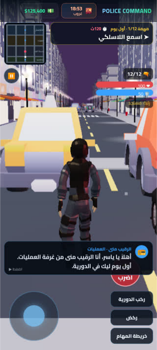
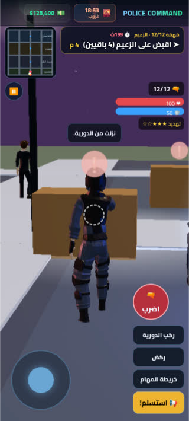

# POLICE COMMAND — قيادة الشرطة

<p align="center">
  
  
  
  
</p>

لعبة شرطة ثلاثية الأبعاد في المتصفح (Three.js + Vite + PWA) بواجهة عربية RTL: حملة قصة من 12 مهمة، ودورية حرة ببلاغات عشوائية، ومطاردات، واعتقالات.

**العب الآن (Vercel):** https://police-command.vercel.app/

## تشغيل محلي
```bash
npm install
npm run dev      # تطوير
npm run build    # بناء الإنتاج إلى dist/
```

## النشر
الاستضافة الوحيدة هي **Vercel** (Framework: Vite · Build: `npm run build` · Output: `dist`). كل دمج في `main` ينشر تلقائياً.

## الترخيص
الكود مرخّص بـ MIT (انظر `LICENSE`). الأصول الخارجية (نماذج وأصوات) لها تراخيصها الخاصة (CC0 / CC-BY)، انظر `CREDITS.md`.

## سجل الإصدارات
## v1.2.1 — بناء ثابت لـ Cloudflare Pages

- المصادر في `src/` مباشرة (لم نعد نعتمد على `scripts/game-parts` التالف)
- دورة نهار/ليل سينمائية من v1.2
- إعداد Pages: `bun/npm build` → مخرجات `dist` (بدون `npx wrangler deploy`)

## v1.2 — دورة نهار/ليل سينمائية

- ساعة مدينة متسارعة (دورة كاملة ~8–12 دقيقة حقيقية، قابلة للضبط من الإعدادات)
- انتقال سلس: صباح → ظهر → غروب → ليل (سماء، شمس/قمر، ضباب، نوافذ، أعمدة إنارة)
- نهار: سماء مضيئة وشوارع مقروءة · ليل: إنارة شوارع ونوافذ بإضاءة سينمائية
- مؤشر ساعة/قمر في الشريط العلوي (صباح / ظهر / غروب / ليل)

## v1.1 — قرارات + إثارة + ديسكتوب/موبايل

- قرارات صريحة قبل الإرسال: **تفاوض / اقتحام / حصار / مطاردة** مع نسبة نجاح وخطر ضباط ومكافأة متوقعة
- بلاغات أطول ومتعددة المراحل (سطو بنك: محيط → اقتحام → اعتقال)
- شجرة تقنيات قابلة للفتح
- بث CCTV حي للبلاغات الحرجة
- واجهة مكتب كثيفة + ورقة تنبيهات موبايل
- صوت خفيف عبر WebAudio
